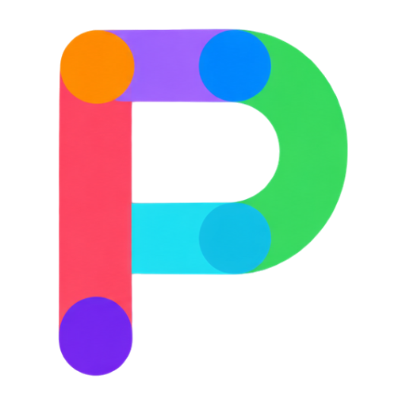

  
  

    <b>Pipfolio</b> is an advanced trading journal and performance analytics platform designed to help traders track trades, evaluate strategies, manage risk, analyse performance, and strengthen trading psychology. Through data-driven insights, Pipfolio supports informed decisions, trading discipline, and continuous improvement.
  

 

> [!NOTE]
> 
Pipfolio provides a comprehensive workspace for managing trading records, reviewing performance, evaluating strategies, and monitoring trading behaviour. It is designed for personal trade journaling and analysis rather than trade execution.

> [!TIP]
> 
Record trades consistently, document strategies, attach screenshots, track emotions and mistakes, and review performance regularly to identify strengths, weaknesses, and opportunities for improvement.

> [!IMPORTANT]
> 
Pipfolio uses Supabase for account authentication and journal data storage. Users should maintain accurate trading records, protect their account credentials, and understand that meaningful analytics depend on reliable information.

> [!WARNING]
> 
Trading financial markets and leveraged instruments involves significant risk, including potential capital loss. Past performance does not guarantee future results. Always assess your financial circumstances and practise responsible risk management.

> [!CAUTION]
> 
Pipfolio is intended for informational and analytical purposes only. It does not provide financial advice, investment recommendations, or trading signals. Users are responsible for their trading decisions and should never disclose passwords, API secrets, or sensitive credentials.

 

  

    
      <a href="https://pipfolio.github.io/"><b>Website</b></a>
      &nbsp;&nbsp;·&nbsp;&nbsp;
      <a href="PRIVACY.md"><b>Privacy Policy</b></a>
      &nbsp;&nbsp;·&nbsp;&nbsp;
      <a href="mailto:pipfolio@proton.me"><b>Contact</b></a>
    
  

  

    
      © 2026 <b>Pipfolio</b>. All rights reserved.
       
      Created and developed by
      <a href="https://github.com/AhndreWalters"><b>Ahndre Walters</b></a>
    
  

